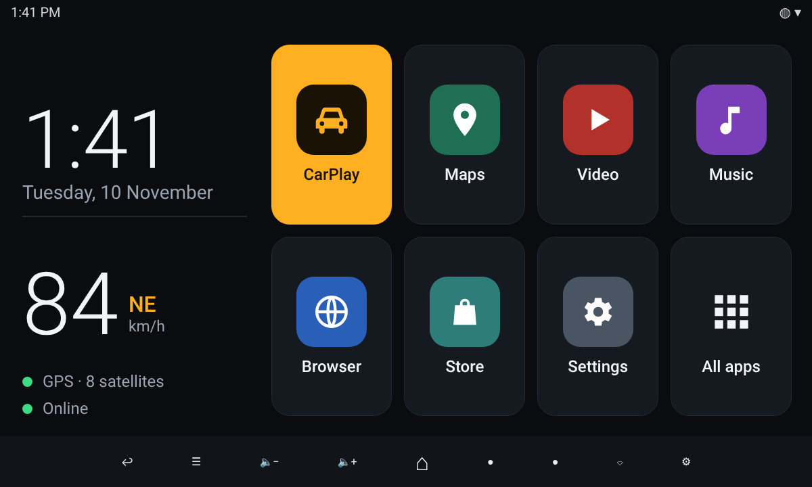

# Masar

A calm, glanceable home screen for Android car head units. *Masar* (مسار) means "route".



*Design preview at 1200×720. Your own app icons and names appear in the tiles.*

## Why

Most car launchers are either phone launchers stretched onto a dashboard or
trial-ware with a paywall. Masar is two pages that do the few things a
driver needs, with targets big enough to hit without looking twice.

- **Eight large tiles.** Seven apps of your choice and an "All apps" tile.
- **CarPlay first.** If the Carlinkit AutoKit app is installed, it takes the highlighted first tile.
- **Clock and date** that follow the system 12/24-hour setting.
- **GPS speed and heading**, plus how many satellites are in use.
- **Internet indicator**, so a dropped hotspot is obvious at a glance.
- **A drive page** one swipe away, with three panels:
  - **Compass** that turns with the direction of travel, plus coordinates and altitude.
  - **Map** that follows the car. Roads already driven stay visible offline, and a tap opens your navigation app.
  - **Weather** where you are: current conditions and the next three days.
- **A home handle** over any app, CarPlay included: touch the screen and a bar with Home, Back, volume and your apps appears for a few seconds. See [Home handle](#home-handle).
- **Scales itself.** Every size is a fraction of the screen height, so it looks the same on any resolution or density.
- No ads, no trial, no account.

The drive page is the only part that uses the internet: map tiles come from
[OpenStreetMap](https://www.openstreetmap.org/copyright) and the forecast from
[Open-Meteo](https://open-meteo.com/). Both receive the car's position, which is
how they know what to send back. The home page works with no connection at all.

## Using it

| Action | Result |
|---|---|
| Tap a tile | Opens the app |
| Long-press a tile | Choose which app lives there, or empty it |
| Tap **All apps** | Full app grid |
| Long-press an app in the grid | Pin to a tile, app info, or uninstall |
| Tap the speed area | Grants location access (needed once, for speed) |
| Swipe sideways, or tap the dots at the bottom | Switches between home and the drive page |
| Tap the map | Opens the position in your navigation app |
| Tap **+** / **−** on the map | Zooms in or out |
| Tap the weather | Refreshes it now |
| Press Home or Back | Returns to the home page |
| Long-press the dots at the bottom, or the handle's status line | Steps the home handle through bar, pill and off |
| Touch the screen in any app | Shows the home bar (or pill) for a few seconds |

## Home handle

Some apps hide the system navigation bar, CarPlay in the Carlinkit AutoKit
app among them, and you may prefer the bar hidden everywhere. The home
handle gives the buttons back on demand: **touch the screen anywhere** and
it appears at the bottom for about four seconds, then goes away.

It has two looks. Long-press the handle's status line on Masar's home page
(or the two page dots) to step through **bar → pill → off**:

- **Bar** (default): a row of buttons like the head unit's own bar. Back,
  Recents, volume down, volume up, Home, and the apps from Masar's tiles 2
  to 4. It works in every app, Masar included.
- **Pill**: a small white capsule. Tap it, or swipe up from it, to go home.
  It covers far less of the screen, and stays away while Masar is in front.

The touch that reveals it still goes to the app underneath as normal. While
it is hidden nothing of Masar's covers the screen. While the bar is showing
it does cover the bottom tenth of the screen, so a control an app puts there
is out of reach for those four seconds; if that gets in the way, use the pill.

**State:** the third status line on Masar's home page says which look is on,
that the handle is off, or that it is waiting for its permission. Tap the
line to grant a missing permission.

**Back and Recents** can only be pressed through an accessibility service,
so Masar has a small one that asks for no events and never reads the screen.
Switch it on once under Settings → Accessibility → *Masar Back and Recents
buttons*, or over adb:

```bash
adb shell settings put secure enabled_accessibility_services cloud.ammarhussein.masar/cloud.ammarhussein.masar.KeysService
adb shell settings put secure accessibility_enabled 1
```

Until then those two buttons open the Accessibility screen. Home, volume and
the app buttons need nothing extra.

**Hiding the system bar everywhere** (Android 10 and older) is a system
setting, not something a launcher can do:

```bash
adb shell settings put global policy_control immersive.navigation=*
```

Undo it with `adb shell settings put global policy_control null`. With it
on, a swipe up from the bottom edge still brings the real bar back briefly.

The handle runs as a foreground service, so Android keeps it alive while
Masar is in the background for a whole drive. A quiet "Home handle is on"
notification is the price of that. After a reboot it comes back as soon as
Masar starts as the home app.

**Permission:** the handle draws over other apps, which needs the "Display
over other apps" permission. Tapping the amber status line opens that system
screen. On head units where the screen is missing or doesn't stick, grant it
over adb:

```bash
adb shell appops set cloud.ammarhussein.masar SYSTEM_ALERT_WINDOW allow
```

Then press Home (or restart Masar). To take the permission away again, use
`deny` instead of `allow`.

## Install

Download `masar.apk` from the [latest release](../../releases/latest), then:

```bash
adb install -r masar.apk
adb shell pm grant cloud.ammarhussein.masar android.permission.ACCESS_FINE_LOCATION
adb shell appops set cloud.ammarhussein.masar SYSTEM_ALERT_WINDOW allow
adb shell cmd package set-home-activity cloud.ammarhussein.masar/.MainActivity
adb shell input keyevent HOME
```

To go back to the previous launcher, set it as home again with
`cmd package set-home-activity <package>/<activity>`, or pick it in
Settings → Apps → Default apps → Home app.

## Requirements

Android 8.0 or newer. Built and tuned on a Rockchip RK3399 head unit running Android 10.

## Build

```bash
./gradlew assembleRelease
```

The APK lands in `app/build/outputs/apk/release/`. There are no dependencies
beyond the Android SDK and the Kotlin standard library. Every push to `main`
makes GitHub Actions build a signed APK and publish it as a new release.

## Licence

MIT
